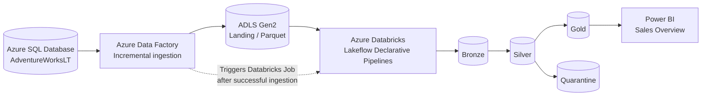
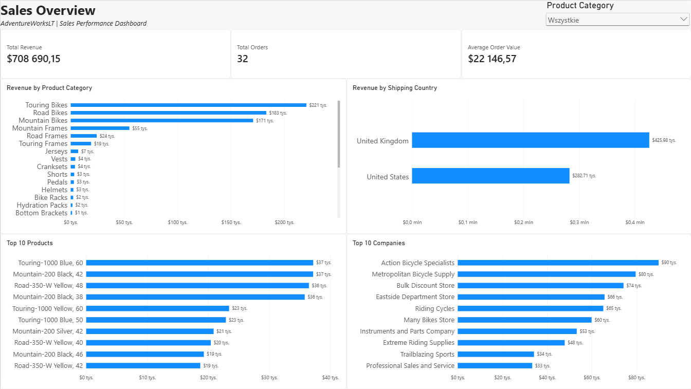

# Azure Data Engineering Portfolio

An end-to-end data engineering portfolio project built around the **AdventureWorksLT** sample database. It demonstrates incremental ingestion from Azure SQL Database, cloud data storage, transformation and quality controls in Azure Databricks, dimensional modeling, and a Power BI sales report.

The project is designed to demonstrate engineering decisions—not just a dashboard—including failure-safe watermark updates, separation of raw and curated datasets, reproducible Databricks pipeline definitions, and automated validation and unit tests.

## Architecture



**Orchestration:** An ADF schedule trigger starts the ingestion master pipeline. After its ingestion activities succeed, ADF invokes a Databricks Job that runs the Lakeflow Declarative Pipeline. Databricks processes the landing files into Bronze, Silver, and Gold datasets.

## Technology Stack

| Area | Technologies |
| --- | --- |
| Source | Azure SQL Database, AdventureWorksLT |
| Ingestion and orchestration | Azure Data Factory (ADF), parameterized pipelines, scheduled trigger |
| Storage | Azure Data Lake Storage Gen2, Parquet |
| Data processing | Azure Databricks, PySpark, Spark SQL, Lakeflow Declarative Pipelines, Auto Loader |
| Catalog and access | Unity Catalog, storage credentials, external location, Azure managed identity |
| Analytical modeling | Delta tables / materialized views, Medallion Architecture, snowflake dimensional model |
| Reporting | Power BI Desktop, DAX |
| Infrastructure | Terraform (selected Azure resources) |
| Version control and CI | Git, GitHub Actions, Databricks Asset Bundles, pytest |

## Data Ingestion: Azure SQL → ADLS Gen2

The source is the **SalesLT** schema of the AdventureWorksLT sample database, hosted in Azure SQL Database.

ADF implements **metadata-driven incremental ingestion**:

1. A master pipeline reads source-table metadata from the SQL control table `etl.Watermark`.
2. A `ForEach` activity invokes a reusable child pipeline for each configured source table.
3. The child pipeline reads the previously processed watermark and determines the current maximum `ModifiedDate`.
4. ADF copies rows in the interval **`ModifiedDate > old_watermark AND ModifiedDate <= new_watermark`** into Parquet files in ADLS Gen2.
5. The stored procedure `etl.UpdateWatermark` updates the control table **only after the Copy activity succeeds**.
6. After ingestion succeeds, the master pipeline starts the Databricks processing Job.

Landing files follow an ingestion-date partition convention:

```text
landing/adventureworkslt/<table>/ingestion_date=YYYY-MM-DD/<schema>.<table>_<run-id>.parquet
```

The pipeline uses **Azure Data Factory managed identity** for the Azure SQL connection. The design avoids advancing the watermark after a failed copy, reducing the risk of missing a batch on retry.

> **Known limitation:** A `ModifiedDate` watermark captures inserted and updated records but cannot detect a source-side hard DELETE on its own. A production system could use CDC / change tracking, deletion markers, or periodic reconciliation. The ingestion logic may also produce an empty Parquet file when there are no new rows; skipping the copy in that case is a potential improvement.

## Transformation: Medallion Architecture

### Bronze — incremental landing-file ingestion

Bronze ingestion uses **Databricks Auto Loader** with Parquet input to discover and process new files from the ADLS landing area. Technical metadata is added, including:

- `_ingestion_timestamp` — when a record enters Bronze.
- `_source_file` — the originating file path (from Spark's `_metadata.file_path`).

Auto Loader tracks files already processed; it does **not** guarantee business-key deduplication. That is handled in Silver.

### Silver — validation, deduplication and quarantine

The Silver transformation is implemented in PySpark using reusable table definitions and testable helper functions.

- **Validation:** primary-key fields and `ModifiedDate` must not be null.
- **Quarantine:** invalid rows are routed to corresponding tables in the `quarantine` schema, with `_quarantine_reason` values such as `NULL_PRIMARY_KEY` and `NULL_MODIFIED_DATE`.
- **Deduplication:** `row_number()` partitions by the table's primary key (including composite keys) and orders by `ModifiedDate DESC`, then `_ingestion_timestamp DESC`; the latest row is kept.
- **Data quality expectations:** additional rules monitor business values (such as non-negative prices and positive order quantities) without duplicating the quarantine conditions.

Silver processing is generic across the configured AdventureWorksLT tables. The primary-key mapping and expectation rules are stored separately from the pipeline definitions.

### Gold — dimensional analytics model

Gold is implemented in **Spark SQL** as Lakeflow-managed materialized views. The dimensional model uses a **snowflake schema** rather than a fully denormalized star schema.

**Fact grain:** one row in `fact_sales` represents **one sales order line** (`SalesOrderID`, `SalesOrderDetailID`). Measures such as `LineTotal`, `OrderQty`, `UnitPrice`, and `UnitPriceDiscount` belong at that grain. Order-header totals are intentionally not duplicated across line items.

| Gold object | Purpose |
| --- | --- |
| `fact_sales` | Order-line sales fact |
| `dim_customer` | Customer details |
| `dim_product` | Product attributes and references to product model/category |
| `dim_product_category` | Product category hierarchy |
| `dim_product_model` | Product models |
| `dim_address` | Geographic/address attributes |
| `dim_date` | Calendar dimension used in multiple date roles |
| `bridge_customer_address` | Customer-to-address associations |

The fact uses `OrderDateKey`, `DueDateKey`, and `ShipDateKey` for different roles of `dim_date`, and shipping/billing address references to `dim_address`. Product category and model are linked through `dim_product`, demonstrating a snowflake structure.

Primary and foreign key relationships are declared in Unity Catalog where supported. **These constraints are informational, not enforced data-integrity guarantees**; validation remains the pipeline's responsibility.

Sanity checks performed during development included comparing fact row counts and `LineTotal` aggregates against the source Silver detail table.

## Data Quality and Testing

The project combines runtime checks with automated tests:

- **Lakeflow expectations:** monitor business data-quality rules during Silver processing.
- **Quarantine:** separates records with invalid mandatory keys or missing modification dates.
- **PySpark unit tests:** cover the reusable Silver transformation helpers:
  - choosing the latest `ModifiedDate` per key;
  - using `_ingestion_timestamp` as a tie-breaker;
  - deduplicating with a composite primary key;
  - validating keys and modification dates;
  - assigning quarantine reasons.

The tests are written with **pytest** and small synthetic Spark DataFrames. They can run in Databricks during development and on a GitHub Actions runner with local Spark.

## GitHub Actions CI

The workflow in [`.github/workflows/databricks-ci.yml`](.github/workflows/databricks-ci.yml) runs on pull requests and pushes targeting `dev`. It:

1. Checks out the repository.
2. Validates the Databricks Asset Bundle with `databricks bundle validate -t dev`.
3. Installs the required Python/Java test environment.
4. Executes Silver unit tests with `pytest`.

**Scope:** This is automated **CI (validation and tests)**, not a claim of a deployed production CD pipeline. The project currently uses a development Databricks workspace; automated promotion/deployment to a separate production environment is a future enhancement.

## Infrastructure as Code

Terraform configuration lives under [`infrastructure/terraform/`](infrastructure/terraform/). It covers selected existing Azure infrastructure, including the Azure Storage account and Azure SQL resources, and was checked for configuration drift with `terraform plan`.

The portfolio uses local Terraform state; a production-ready implementation would use a secure remote backend and appropriate state locking/access controls. Secrets, state files and local Terraform caches should not be committed.

## Power BI — Sales Overview

Power BI Desktop connects to a **Databricks SQL Warehouse** and imports the Gold model. The report includes:

- **Total Revenue** — `SUM(fact_sales[LineTotal])`.
- **Total Orders** — distinct count of `SalesOrderID` (because the fact grain is order line).
- **Average Order Value** — Total Revenue divided by Total Orders.
- Revenue by product category.
- Revenue by shipping country.
- Top 10 products by revenue.
- Top 10 companies by revenue.
- Interactive product-category filtering.



**Dashboard file:** [`powerbi/Sales_Overview.pbix`](powerbi/Sales_Overview.pbix)

The report uses shipping address as the active geography relationship and order date as the active date relationship. The sample order data in this project is concentrated on **June 1, 2008**, so a meaningful month-over-month or year-over-year sales trend cannot be demonstrated with the current dataset. The date dimension and relevant keys are still present in Gold.

> The `.pbix` report uses the **Import** mode and therefore includes a snapshot of the sample data. It may also contain connection metadata; do not store authentication tokens, secrets or sensitive production data in a public repository.

## Repository Structure

```text
.
├── .github/
│   └── workflows/                 # GitHub Actions CI
├── adf/                           # Azure Data Factory artifacts
├── data_engineering_portfolio/    # Databricks Asset Bundle, pipelines and tests
│   ├── databricks.yml
│   ├── resources/
│   ├── src/
│   ├── tests/
│   └── pyproject.toml
├── infrastructure/
│   └── terraform/                 # Selected Azure resource definitions
├── powerbi/
│   ├── Sales_Overview.pbix
│   └── sales_overview.png
└── README.md
```

## Design Decisions and Trade-offs

- **ADF for ingestion, Databricks for processing:** keeps cross-service data movement separate from Spark transformations.
- **Watermark-based extraction:** simpler and appropriate for this sample, but does not detect hard deletes.
- **Parquet landing zone:** preserves ingested files separately from curated Delta datasets.
- **Medallion architecture:** separates ingestion history, validated data, and analytics-ready outputs.
- **Reusable Silver logic:** enables unit testing without invoking the full Lakeflow pipeline.
- **Snowflake Gold model:** demonstrates normalized dimensions and relationships; a star schema may be simpler for some reporting workloads.
- **Import-mode Power BI:** suitable for the small sample dataset and avoids continuous queries to the SQL Warehouse during dashboard interaction.
- **CI without automated production CD:** reflects the actual single-development-environment setup rather than implying an unimplemented release process.

## Potential Improvements

- Add CDC/change tracking or reconciliation for source deletes.
- Skip ADF Copy when no rows are available in an incremental window.
- Introduce separate dev/prod environments and automated bundle deployment.
- Add integration tests for Gold model integrity and aggregates.
- Expand alerting, run monitoring, and operational recovery procedures.
- Harden network access, secrets management, and Terraform remote state.
- Use a richer dataset with multiple sales periods for meaningful time-series and YoY/QoQ reporting.

## Project Context

This is a **learning and portfolio project**, not a production deployment. It focuses on demonstrating end-to-end data engineering concepts and explaining the design and operational trade-offs behind them.
